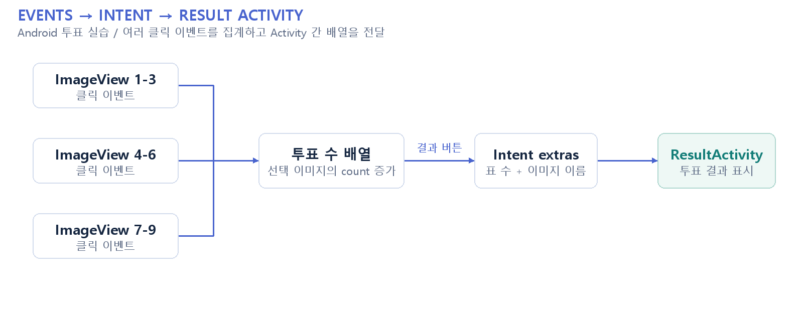

# 명화 선호도 투표 / Android 실습

**Kotlin UI 이벤트와 Activity 간 데이터 전달**

[구성도 SVG 원본](docs/portfolio/architecture.svg)

## 프로젝트와 담당 범위

교내 모바일앱 프로그래밍 실습입니다. 9개 ImageView에 클릭 이벤트를 연결해 투표 수를 누적하고, Intent에 표 수와 이미지 이름 배열을 담아 ResultActivity로 전달합니다. Kotlin·Android View·이벤트 처리의 기초 경험이며 AI 모델이나 실제 서비스 운영 성과를 포함하지 않습니다.

## 구현 근거

[입력 화면](app/src/main/java/com/example/myapplication/MainActivity.kt) · [결과 화면](app/src/main/java/com/example/myapplication/ResultActivity.kt)

